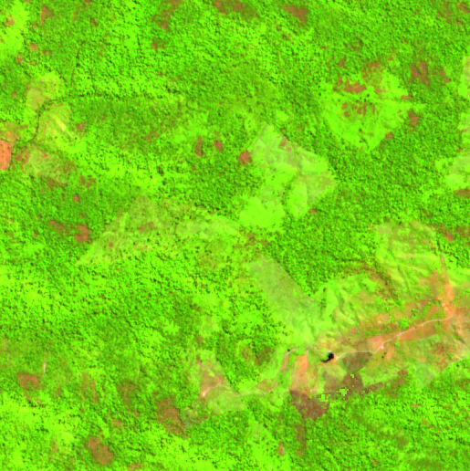
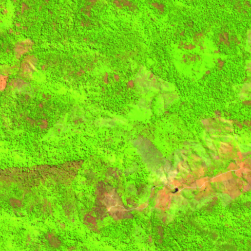
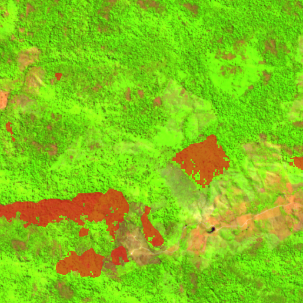
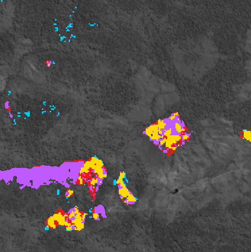

# Spotting forest loss from space

This project looks at satellite photos of the same place in two different years and finds
where forest has been cut down in between. It draws the cleared areas on a map and tells you
how much forest was lost, in hectares (1 hectare = 100 m × 100 m, about the size of a
football pitch).

It was built and tested on São Félix do Xingu in Pará, Brazil, one of the fastest-clearing
parts of the Amazon. It compares 2020 with 2022.

| 2020 | 2022 | What the model found |
|---|---|---|
|  |  |  |

*A 5 km × 5 km area that the model never saw while learning. In these "false color" images,
forest is bright green and bare land is pink or brown. Red marks the forest the model says
was cleared: about 186 hectares here.*

---

## Why this matters

Forests are being cleared faster than people can check on the ground. Satellites photograph
the whole planet every few days for free, but no one can look through all those pictures by
hand. A program that compares the pictures automatically can point out new clearing quickly,
so people can decide where to look closer.

## How it works, step by step

**1. Collect the pictures.** Two kinds of free satellite data from the European Space Agency
are used:
- **Sentinel-2** takes ordinary photos, plus some colors our eyes can't see that are very good
  at telling healthy plants from bare soil. Clouds block it, though.
- **Sentinel-1** is a radar. It sends out its own signal and measures the echo, so it sees
  through clouds and works at night. Forest and cleared land echo differently.

**2. Make one clean picture per year.** The Amazon is cloudy, so no single photo is clear.
For each year, the project takes every photo from the dry season (June to September), throws
away the cloudy parts and keeps the typical value for each spot. The result is one cloud-free
picture per year, with 10 m × 10 m pixels.

**3. Get the answers to learn from.** A well-known forest map made by researchers at the
University of Maryland (the *Hansen Global Forest Change* map) records which pixels lost
forest, and in which year. These records are the "answer key" the computer learns from.

**4. Teach the computer.** A *neural network* is a program that learns patterns from
examples instead of following hand-written rules. It was shown about 840 small squares of
the region, each 2.56 km wide, with the 2020 picture, the 2022 picture and the answer key.
Over many rounds it learned what forest loss looks like.

**5. Test it fairly.** The southern strip of the region was kept completely hidden during
learning. All the accuracy numbers below come from that unseen strip, the same way a
student is tested on questions they haven't seen before.

**6. Clean up the result.** Two simple rules remove common mistakes:
- Only count loss where there actually *was* forest at the start. Old pastures change color
  with the seasons and were the main cause of false alarms.
- Ignore tiny specks smaller than 1 hectare, which are usually noise.

**7. Use it anywhere.** A small web app lets you pick a point on the map and two years.
It downloads the pictures, runs the model and shows the result in under a minute.

## How well does it work?

Measured on the hidden southern strip, averaged over 3 separate training runs:

| Question | Answer |
|---|---|
| When it says "forest was cut here", how often is it right? | About **7 times out of 10** (precision 0.69) |
| Of all the forest that was actually cut, how much does it find? | About **half** (recall 0.53) |
| Overall score (F1, 0 = useless, 1 = perfect) | **0.60** |
| Total area | It found about 1,220 ha against 1,609 ha recorded, so it **underestimates by about a quarter** |

What these numbers mean in practice:
- It is good at finding **large, clear-cut areas**. It misses many small or gradual changes,
  such as thinning or narrow strips.
- Many of its "mistakes" are probably not real mistakes. The answer key dates loss by
  calendar year, while the pictures are from June to September. Clearing in late 2020 or
  early 2022 really did happen between the two pictures, but the answer key says otherwise.
  The app shows this kind of loss in its own color (purple) so you can see it.
- Two designs were compared: a standard network that sees both years at once, and a
  "Siamese" network that looks at each year separately and then compares them. They scored
  about the same (0.59 vs 0.60, within run-to-run variation). The app uses the Siamese one.

### Comparison with the forest map



- **Yellow:** the model and the forest map agree.
- **Red:** only the model found loss.
- **Cyan:** only the forest map shows loss (the model missed it).
- **Purple:** the model found loss that the map dates to 2020 or 2022. It is usually real, just
  on the edge of the time window.

## Limits to keep in mind

- **One place, one time span.** The model only learned from this region and from a 2-year gap.
  The app will run anywhere and for other years, but nobody has measured how accurate it is
  there. The app shows a warning in those cases.
- **Not a legal or official measurement.** Treat the results as "places worth checking", not
  as proof.
- **Small areas only.** The app handles up to 10 km × 10 km at a time to keep downloads and
  free-tier quota small.
- **Years 2019 to 2026.** The cloud-free satellite data needed starts in 2019, and the forest
  map used for comparison stops at 2025.

## Small glossary

| Term | Meaning |
|---|---|
| Pixel | One 10 m × 10 m square of ground |
| Hectare (ha) | 100 m × 100 m, or 100 pixels |
| False color | Using invisible colors (infrared) to make plants stand out as bright green |
| Neural network / model | A program that learns patterns from examples |
| Training | Showing the model examples with answers so it learns |
| Precision / recall / F1 | How often it's right when it says "loss" / how much real loss it finds / both combined |
| Earth Engine | Google's free service for processing satellite data, where the pictures come from |

---

## Running it yourself

### What you need
- Windows or Linux, Python 3.11 and an NVIDIA graphics card (it was built on an RTX 4060 laptop).
- A free [Google Earth Engine](https://earthengine.google.com/) account with a Cloud project.
  Put the project ID in `configs/default.yaml`.

### Install

Run these from the project folder. With [uv](https://docs.astral.sh/uv/):

```powershell
uv venv --python 3.11 .venv
.venv\Scripts\activate
uv pip install -r requirements-torch.txt
uv pip install -r requirements.txt
earthengine authenticate
```

Or with plain pip (use `source .venv/bin/activate` on Linux):

```powershell
python -m venv .venv
.venv\Scripts\activate
pip install -r requirements-torch.txt
pip install -r requirements.txt
earthengine authenticate
```

Install `requirements-torch.txt` first. Otherwise a CPU-only version of PyTorch gets installed
on Windows.

Check that everything works:

```powershell
python -m scripts.check_env   # config, packages, graphics card
pytest                        # automated tests
```

### Try the app

You need a trained model in `outputs/runs/` (see "Rebuilding from scratch" below). Then run:

```powershell
python -m app.app
```

Open the address it prints (http://127.0.0.1:7860). Enter a latitude and longitude, pick a box
size and two years, and click **Detect forest loss**. Tip: in Google Maps, right-click a spot
to copy its coordinates. Maps gives latitude first.

Each new area uses a little of your Earth Engine quota. Repeating the same area and years
reads a saved copy from `data/app_cache/` and is free. Results are saved in `outputs/app/`:
- a GeoTIFF map file you can open in QGIS (layer 1 = loss, layer 2 = confidence in %);
- the images;
- a `summary.json` with the hectare numbers.

The same thing without the browser:

```powershell
python -m scripts.predict_area                                                   # default test area
python -m scripts.predict_area --bbox -52.28 -6.81 -52.24 -6.77 --before 2021 --after 2023
```

App settings (model, area limit, allowed years) are in `configs/app.yaml`.

### Rebuilding from scratch

These steps download the data and train the model again. Exports use Earth Engine quota, so
the bigger ones need `--confirm`. The whole region used about 15 of the 150 EECU-hours in the
free Community tier.

1. **Check and export the data:**

   ```powershell
   python -m scripts.check_s1_coverage                             # radar images per pixel
   python -m scripts.report_labels                                 # how much loss each labelling rule keeps
   python -m scripts.export_stack --area subset --confirm --wait   # NE quarter; repeat with nw, sw, se
   ```

   Download the exported `.tif` files from Google Drive into `data/raw/`.

2. **Cut the data into training squares:**

   ```powershell
   python -m scripts.make_patches --area full
   python -m scripts.view_patches --area full
   ```

3. **Train and evaluate.** On an RTX 4060, each training run takes under 10 minutes:

   ```powershell
   python -m scripts.train --train-config configs\train\siamese_unet_resnet34.yaml --seed 42
   python -m scripts.evaluate --run siamese_unet_resnet34_seed42
   python -m scripts.plot_evaluation --run siamese_unet_resnet34_seed42
   python -m scripts.diagnose_errors --run siamese_unet_resnet34_seed42 --split val
   ```

   The standard network uses `configs\train\unet_resnet34.yaml`. To compare several runs:

   ```powershell
   python -m scripts.compare_models --model "Siamese U-Net=siamese_unet_resnet34_seed42,siamese_unet_resnet34_seed1"
   ```

`notebooks/project_walkthrough.ipynb` walks through the whole project step by step.

### Project layout

```
app/        the web app
configs/    settings files (region, years, training, app)
src/        the main code: data/, models/, training/, inference/
scripts/    commands for each step
tests/      automated tests
notebooks/  step-by-step walkthrough
docs/       images for this page
data/       downloaded satellite data (not stored in git)
outputs/    trained models, scores, figures (not stored in git)
```

### Technical details

- **Input:** 24 layers per location. For each year these are 10 Sentinel-2 bands plus the radar
  VV and VH bands, from dry-season median composites at 10 m in EPSG:32722.
- **Labels:** from Hansen GFC v1.13. 2021 loss in pixels with at least 50% tree cover in 2000
  counts as loss. 2020 and 2022 loss is ignored during training and scoring, because it may
  fall either side of a composite.
- **Models:**
  - early-fusion U-Net with a ResNet-34 encoder;
  - Siamese U-Net: a shared encoder, with each scale fused as `[before, after, |after − before|]`.
- **Training:** Dice + focal loss, AdamW, mixed precision, and extra sampling of patches with loss.
- **Data split:** north-to-south stripes for training, tuning and testing, separated by 2.56 km buffers.
- **Post-processing:**
  - the threshold is tuned on the validation stripe;
  - a forest-at-start mask from Hansen data before the period;
  - detections under 1 ha are removed.
- **App:**
  - fetches pixels with `ee.data.computePixels` in 512 px tiles on the same grid as the training data;
  - predicts with overlapping 256 px tiles, blended with a tapered window.
- **Detailed results:** `outputs/comparison/results_table.md` and `outputs/runs/<run>/evaluation/metrics.json`.
